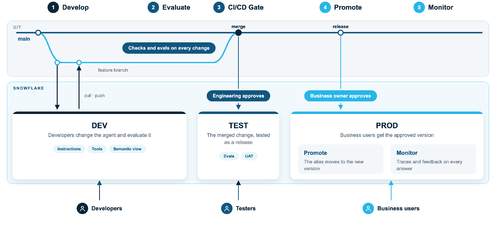

# Cortex Agent Ops

A template that takes a Cortex Agent you already have and puts it into a
**dev, test and prod** flow: Git for every change, an evaluation against what the
business calls a good answer, approval gates that move from engineering to the
business, and a release you can roll back by moving an alias.

## Why

If you change any part of an agent (its instructions, its semantic view, its
tools), you have changed the agent. This template makes every such change:

1. go through Git and a pull request,
2. get scored against business-owned questions,
3. be approved by the right people, in the right order,
4. be traceable: who asked, who approved, how it was tested, when it shipped.

## What you bring and what you get

| You bring | The template gives you |
|---|---|
| A working Cortex Agent, built any way: Snowsight, a spec YAML, the `agent-studio` skill, or [spn-demo-creator](https://github.com/sfc-gh-makukreja/spn-demo-creator) | `adopt-agent` skill that exports it and writes it with DEV names |
| Your data, in `<NAME>_DEV`, `_TEST`, `_PROD` databases | Generated DCM project: agent home, stages, one audience role per environment with exactly the grants the agent needs |
| 4 to 8 business questions with what a good answer contains | Evaluation on every test deploy, reported on the run page for the approver |
| A GitHub repo and a Snowflake account | Workflows for pull request, main (test then prod) and rollback; OIDC login with no stored secrets |

## The three steps

1. [Adopt your agent](adopt.md): `ops adopt` and `ops generate`.
2. [Set up CI/CD](setup.md): bootstrap Snowflake, create the GitHub environments, create the agent in each environment.
3. Ship a change: open a PR, merge, read the evaluation, approve prod. Roll back with one workflow.

!!! note "Not in scope"
    The agent's **data** is yours. The template gives a [naming convention](naming.md)
    and an optional script to clone environments, nothing more.
