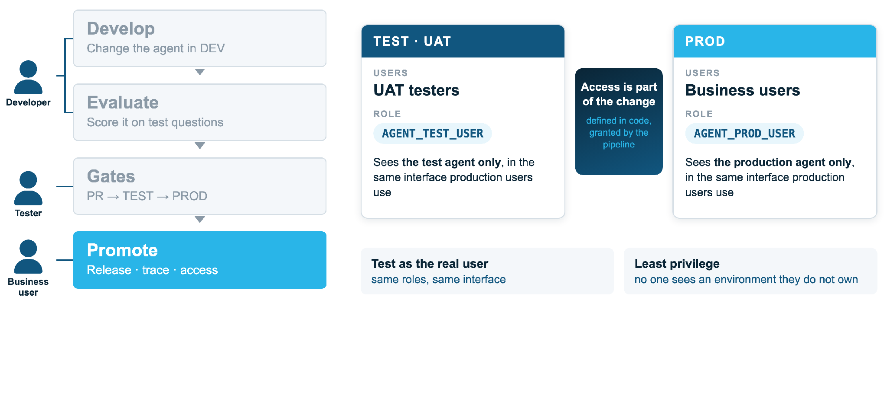

# Access by environment



**Access is part of the change.** It is defined in code, granted by the pipeline, and
gives each audience exactly one environment's agent.

| Environment | Users | Role | Sees |
|---|---|---|---|
| TEST (UAT) | UAT testers | `<AGENT>_TEST_USER` | The test agent only |
| PROD | Business users | `<AGENT>_PROD_USER` | The production agent only |

- **Test as the real user:** same roles, same interface (CoWork).
- **Least privilege:** no one sees an environment they do not own.

`ops generate` writes `dcm/sources/definitions/access/access.sql` from the adopted
agent: for each tool, only the grants it needs (the agent, semantic views and their base
tables, search services, functions, procedures). CoWork signs a user in with their
default role, so set it to the audience role. Map the users in `agentops.yml`:

```yaml
audiences:
  TEST: UAT_USER
  PROD: PROD_USER
```

Engineers work in DEV as themselves; add a developer role per environment, and a shared
reader role per dataset, in the same file for production use.
