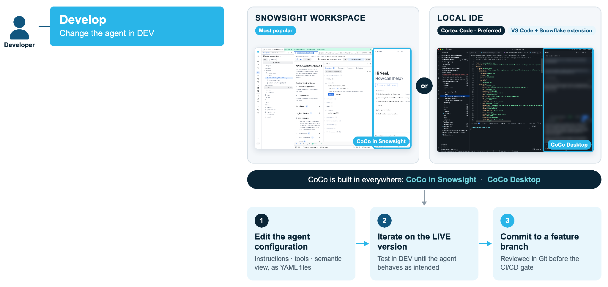

# 1. Develop

Developers change the agent in DEV, either in a Snowsight Workspace with Cortex Code
built in, or in a local IDE with Cortex Code Desktop.

1. **Edit the agent configuration.** Instructions, tools and the semantic view are
   YAML files in this repo (`agent/`), always written with DEV names.
2. **Iterate on the live version.** Test in DEV until the agent behaves as intended.
3. **Commit to a feature branch.** It is reviewed in Git before the CI/CD gate.

!!! tip "One source of truth"
    The agent in Git is the truth. A change made in Snowsight but never committed
    is not part of any release, and a leftover live version will block the next
    `ADD VERSION` (see [Gotchas](../gotchas.md)).
