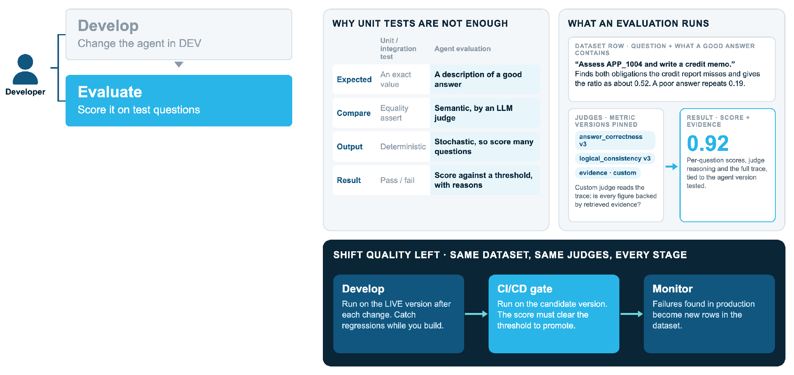

# 2. Evaluate

An agent is stochastic and its answers are language, so an exact-value assertion is
the wrong test. An evaluation scores the answer against a **description of a good
answer**, using an LLM judge, across many questions.

## What the template runs

- **Dataset:** `evals/questions.yml`. Each row is a question and what a good answer
  contains. They are owned by the business, written before the change is built.
- **Judges:** `answer_correctness` and `logical_consistency` (versions pinned), set in
  `ops eval-config`. Add a custom judge to the generated config if your agent needs one
  (for example "is every figure backed by retrieved evidence?").
- **Run:** `ops/evaluate.sql` scores the version just added, named
  `TEST-<commit>-<attempt>`, so Snowsight's Evaluations tab shows the same run with a
  trace per question.
- **Report:** `ops/eval_report.sql` writes markdown to the run page, including the
  judge's own reason for every mark lost.

## Shift quality left

The same dataset and judges run at every stage: on the live version while you develop,
on the candidate version at the gate, and failures found in production become new rows
in the dataset.

!!! warning "Reported, not blocking"
    The slides show a score below a threshold blocking promotion. This template
    **reports** the evaluation next to the prod approval and blocks only when the run
    fails to complete. Agent scores vary run to run, so they point at a behaviour for
    a person to read. To make it blocking, add a step after "Evaluation report" in
    `.github/workflows/_deploy.yml` that fails when the aggregate score is below your
    bar.
