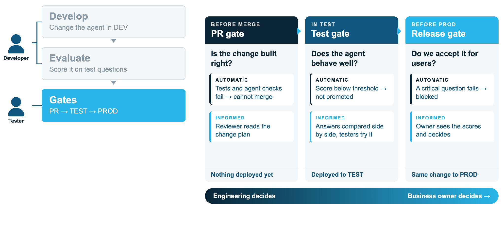

# 3. Gates

Each gate asks a different question, of a different person.

| Gate | Question | Automatic | Informed | Nothing is deployed beyond |
|---|---|---|---|---|
| **PR** | Is the change built right? | Tests; spec and semantic views render; DCM plan; semantic view validates against DEV | Reviewer reads the plan posted on the PR | Nothing deployed yet |
| **Test** | Does the agent behave well? | Deploys to TEST; the run must complete | Evaluation report; testers try it in UAT | TEST |
| **Release** | Do we accept it for users? | Prod deploys only after approval | The business owner reads the scores and decides | PROD |

**Engineering decides first; the business owner decides last.** Configure this in
GitHub: required reviewers on the `main` ruleset (engineering), on the `test`
environment (engineering) and on the `prod` environment (the business).

## In the workflows

| Workflow | Trigger | Does |
|---|---|---|
| `pr.yml` | Pull request | Tests, render, DCM plan against dev posted as a PR comment |
| `main.yml` | Merge to `main` | `test` then `prod`, both through `_deploy.yml` |
| `_deploy.yml` | Called per environment | DCM deploy, semantic views, new agent version, evaluation (test), promote, GitHub Release (prod) |
| `rollback.yml` | Manual | Moves `PROD` back to an earlier release |

A run waiting for approval holds the queue, and a newer merge replaces any run still
waiting to start.
