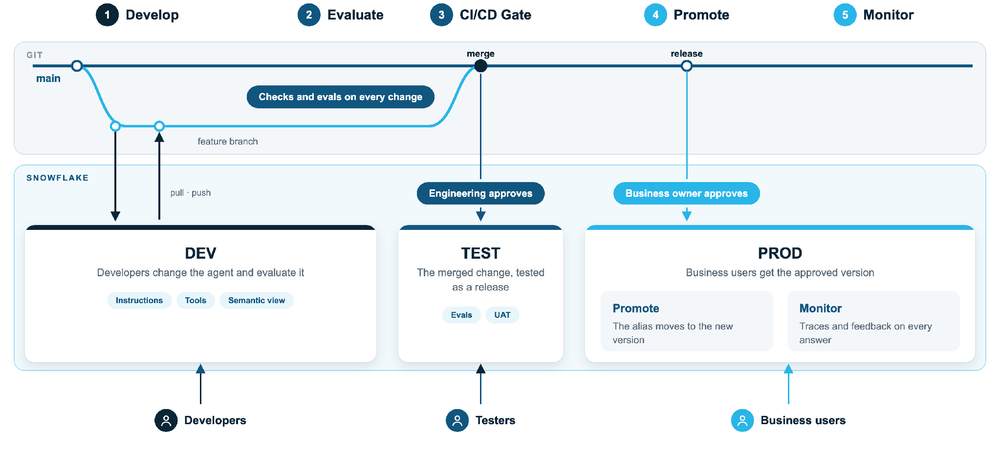

# The lifecycle in practice

Five steps, three environments, and approvals that move from engineering to the
business as the change gets closer to users.

| Step | Where | Who | What this template does |
|---|---|---|---|
| 1. [Develop](develop.md) | DEV | Developers | You change the agent as YAML and commit to a feature branch |
| 2. [Evaluate](evaluate.md) | DEV, TEST | Developers, testers | Scores the agent against business-owned questions |
| 3. [Gates](gates.md) | PR, TEST, PROD | Engineering, then the business | PR plan, test deploy with an evaluation report, prod approval |
| 4. [Promote](release.md) | PROD | Business users | Adds a version, moves the `PROD` alias; rollback moves it back |
| 5. [Monitor](monitor.md) | PROD | Everyone | Traces per answer, tied to the agent version |

Two threads run through all five: [every release is traceable](traceability.md)
to a commit, and [access is part of the change](access.md).
