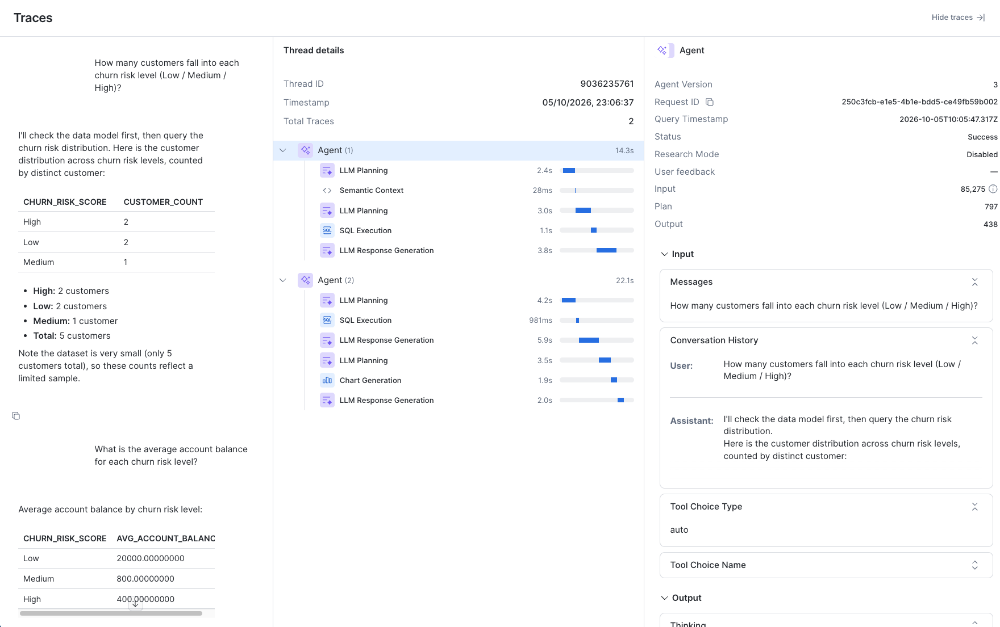

# 5. Monitor

Every answer in production leaves a trace tied to the **agent version** that produced
it. In Snowsight, open AI & ML, Agents, your agent, then the Traces view to see the
thread details and spans for each turn.

Monitoring closes the loop back to evaluation: a failure found in production becomes a
new row in `evals/questions.yml`, so the next change is tested against it.

!!! info "Not included in this template"
    Alerting and dashboards on agent quality are not wired up here. The traces and the
    version-to-commit trail ([Traceability](traceability.md)) are the starting point.
