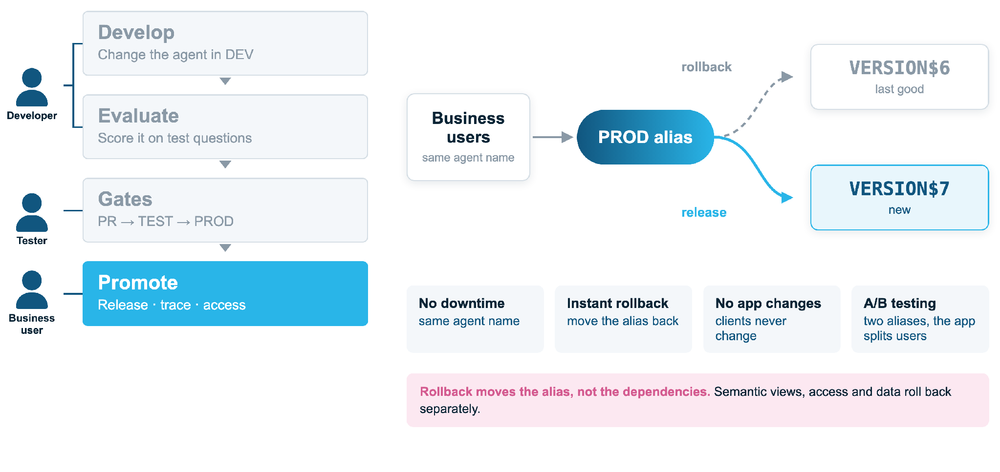

# 4. Release and rollback

Business users call the agent by the same name. Releasing moves the `PROD` alias to
the new version; rolling back moves it back.

| | |
|---|---|
| **No downtime** | Same agent name |
| **Instant rollback** | Move the alias back |
| **No app changes** | Clients never change |
| **A/B testing** | Two aliases, the app splits users |

## How

- `ops/release.sql` uploads the rendered spec to the spec stage under the commit and runs
  `ALTER AGENT ... ADD VERSION FROM @stage/<commit>/ COMMENT = '<note>'`.
- `ops/promote.sql` finds the newest version whose comment starts with the commit,
  sets `ALIAS = PROD` on it and **pins the default** to that version. An unpinned default
  follows every new version, so a release would go live before promotion.
- **Rollback** is the same call with an earlier commit: run the *Rollback* workflow with a
  release name (`2026.10.13-1`) or a commit.

!!! warning "Rollback moves the alias, not the dependencies"
    Semantic views, access and data have no versions here. A fix to them rolls
    **forward** through `main`, so a breaking tool change should ship under a new name.
