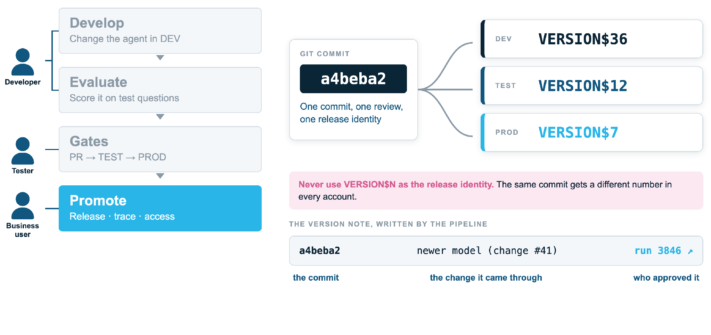

# Traceability



**One commit, one review, one release identity.** The same commit becomes a different
`VERSION$N` in DEV, TEST and PROD, so never use `VERSION$N` as the release identity.

The pipeline writes every version's comment as:

```
<commit> · <commit subject> · <run link>
```

For example `a4beba2 · newer model (change #41) · https://github.com/.../actions/runs/3846`.

| Part | Answers |
|---|---|
| The commit | What exactly is running |
| The subject (names the PR) | The change it came through |
| The run link | Who approved each environment |

`ops/promote.sql` looks the version up by that commit prefix, which is also what makes
rollback by commit or release name possible. Releases are named by date
(`2026.10.13-1`) and created only after prod has deployed.
